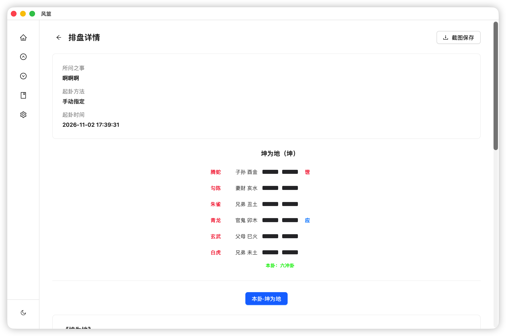
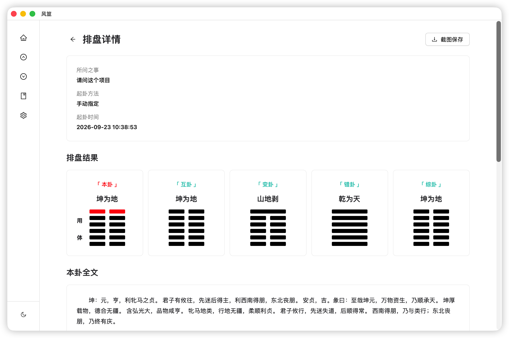

# 风筮 (Windnote)

风筮是一款基于《易经》的桌面占卜应用，支持**六爻起卦**和**梅花易数**两种传统占卜方法。内置六十四卦解卦库，帮助用户在决策困惑时寻求指引。

> 心诚则灵，遇事不决问东风。

## 功能

### 六爻起卦
- **自动起卦**：基于时间种子自动生成六爻
- **手动起卦**：逐爻选择（少阴、少阳、老阴、老阳）
- 支持**变卦**计算，自动推演本卦与变卦
- 显示纳甲、六亲、六神等传统信息
- 卦象截图保存

### 梅花易数
- **数字起卦**：输入 3 位数字，自动计算上卦、下卦与动爻
- **手动起卦**：逐爻设定，支持指定动爻
- **时辰加成**：可选是否用时序数参与计算
- 体用生克分析

### 解卦库
- 六十四卦完整收录
- 支持卦名、卦象搜索
- 每卦配有卦辞、彖传、象传等原文

### 今日黄历
- 首页展示当前日期信息（公历、农历、干支、生肖）
- 宜忌、财神方位等信息

## 截图预览

| 首页 | 六爻详情 | 梅花详情 |
|:---:|:--------:|:--------:|
|  |  |  |

## 技术栈

### 框架
- **桌面壳**：[Wails v3](https://v3.wails.io/) — Go 驱动的原生桌面应用框架
- **前端**：React 18 + TypeScript + React Router 7
- **后端**：Go（Wails Service）

### 前端依赖
| 依赖 | 用途 |
|------|------|
| [Ant Design 6](https://ant.design/) | UI 组件库 |
| [@ant-design/icons](https://github.com/ant-design/ant-design-icons) | 图标集 |
| [Zustand](https://github.com/pmndrs/zustand) | 轻量状态管理 |
| [Vite 8](https://vitejs.dev/) | 前端构建工具 |
| [html-to-image](https://github.com/bubkoo/html-to-image) | 卦象截图导出 |

### 后端
- **Go 1.26**
- **Wails v3.0.0** — 窗口管理、系统对话框等原生能力

## 快速开始

### 前置要求
- Go 1.26
- [pnpm](https://pnpm.io/) 9
- Wails v3 CLI

### 安装

```bash
go install github.com/wailsapp/wails/v3/cmd/wails3@v3.0.0
```

### 运行

```bash
# 开发模式。会安装前端依赖，并在 9245 端口启动 Vite
wails3 task dev
```

### 构建与打包

```bash
# 编译当前系统的生产版本，产物在 bin/
wails3 task build

# 打当前系统的安装包
# macOS: bin/windnote.dmg
# Windows: bin/windnote-amd64-installer.exe（需要 makensis）
# Linux: bin/*.deb，同时还会尝试 AppImage、rpm 和 Arch 包
wails3 task package
```

`wails3 task build` 会执行 `pnpm install`、前端构建，再把 `frontend/dist` 嵌入 Go 程序。

### 仅构建前端（调试用）

```bash
cd frontend
pnpm install
pnpm run build    # 生成 frontend/dist/
```

## 版本与发布

界面上的版本来自 `zhanbu/app.go` 的 `GetAppVersion()`。安装包里的版本写在这些文件里：

- `build/config.yml` 的 `info.version`
- `build/darwin/Info.plist`
- `build/windows/info.json` 和 `build/windows/nsis/wails_tools.nsh`
- `build/linux/nfpm/nfpm.yaml`

推送 `vX.Y.Z` 格式的 tag 后，`.github/workflows/release.yml` 会用 tag 上的版本覆盖上述字段（只改 CI 工作区，不提交回仓库），然后在三个系统上打包并发布 GitHub Release：

| 系统 | 产物 |
|------|------|
| macOS（Apple Silicon） | `windnote-X.Y.Z-macos-arm64.dmg` |
| Windows | `windnote-X.Y.Z-windows-amd64-setup.exe` |
| Ubuntu 24.04 | `windnote-X.Y.Z-linux-amd64.deb` |

```bash
git tag v0.2.0
git push origin v0.2.0
```

tag 必须是三段数字，例如 `v0.2.0`。Windows 安装包的版本号不接受 `v0.2.0-beta` 这种写法。

## 项目结构

```
windnote/
├── main.go                 # Go 入口，Wails 应用初始化
├── zhanbu/                 # 后端：版本、截图、黄历、卦例记录
├── Taskfile.yml            # 开发、构建、打包任务
├── build/config.yml        # 应用信息与版本
├── .github/workflows/      # 按 tag 自动打包并发布
├── go.mod / go.sum
└── frontend/               # React + TypeScript
    ├── package.json
    ├── vite.config.ts
    └── src/
        ├── App.tsx
        ├── pages/          # 首页、六爻、梅花、解卦库、设置
        ├── components/
        ├── stores/
        └── values/         # 卦象与经文数据
```

## 数据来源

- **六十四卦经文**：取自《周易》原文（卦辞、彖传、象传）
- **农历信息**：通过 Go 后端代理请求公开 API 获取实时农历、干支、生肖数据

## 许可

该项目使用 [MIT License](LICENSE)。
